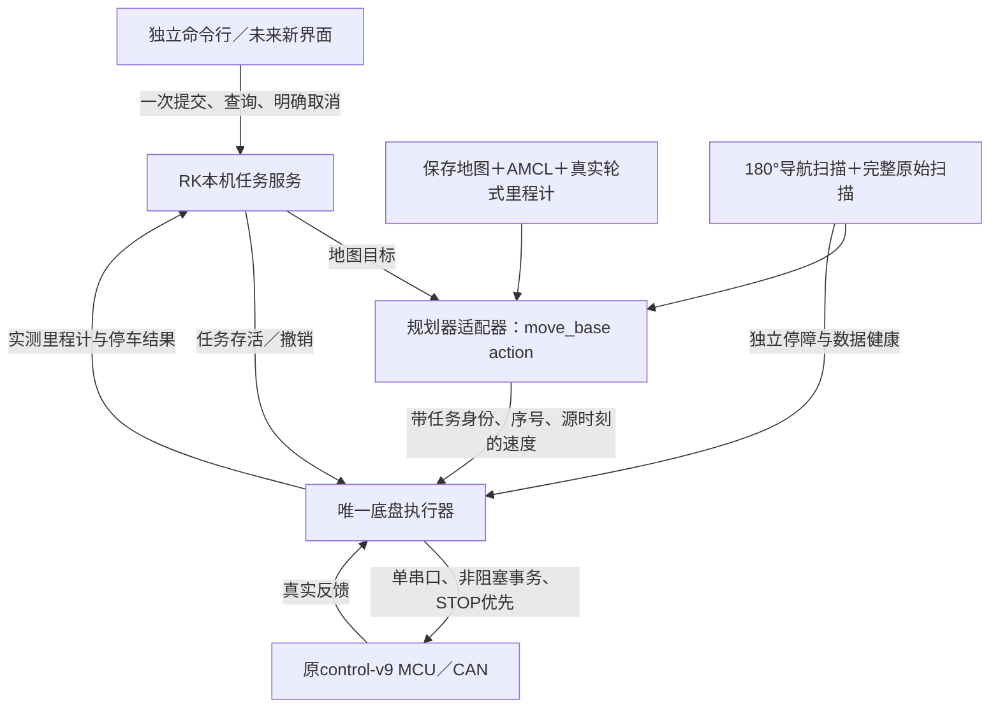

# 独立点到点导航设计

**手推新地图r5已按用户要求结束并保存。** 本轮以用户地面标记和车头方向建立独立odom原点，从空白地图采集；最终480×640格、5厘米/格、已知39661格，记录无缺段、无首故障，原点、PGM/YAML、完整grid及原始记录均在RK和PC保留。结束后的实际清点无AMCL／地图服务／导航／SLAM或控制口owner。手推链全程只查询轮速，未发ARM、SETPOINT或STOP。详见[手推建图说明](MANUAL_MAPPING.md)及[本轮保存结果](MANUAL_MAPPING_RESULT.md)。下文半米验收与旧地图结果均为历史记录，不能自动恢复；本轮保存不代表导航定位精度已验收。

日期：2026-11-03。此目录包含独立导航内核、实车静止定位／路径预览，以及新的一次性半米行驶验收程序，不依赖原8088页面、网页心跳、旧任务生成器或多级准备收据。**半米验收尚未通过：用户整车重启已清UART故障；r6发出19个非零给定，约1.30秒后因AMCL原源超龄停车，实际轮速与编码器仅有很小变化，地面余距待测。** 后续恢复及独立五新零源停车确认通过，控制口已释放。正在成对修正低速里程计与真实扫描测量更新；见[本次行驶验收记录](MOTION_ACCEPTANCE_REPORT.md)，更早的静止与预览见[历史实车记录](INTEGRATION_REPORT.md)。

最新39文件包在PC和实际RK分别通过同一182项软件测试，均0跳过。preview r2使用与首轮完全相同的源码和archive，仅修正启动环境`CMAKE_PREFIX_PATH=/opt/ros/noetic`。在本轮新定位和当前扫描／AMCL／TF复核通过后，私有GlobalPlanner只调用一次make_plan，得到22点、长0.512142543米的路径；路径中心采样格全部已知、实测代价最大0。首轮插件加载失败（move_base退出-6、make_plan调用0次）原始结果保留。

同一底盘owner静止查询120.000397500秒，全部4451个实测反馈左右均0RPM；初末各有新STOP ACK→健康STATUS→五个新零速源。110.05048秒定位观察期间收到1653帧前180°扫描、1064帧odom TF和270个AMCL源。质量拒绝共5条：2条种子前源、3条发生在路径预览之后的协方差超限；最新通过状态被清除，末组五个新源证明结束前已恢复合格。中间失效区间和首次恢复时间未完整留存，不能声称全程定位质量稳定。

上两段为**先前静止定位与路径预览的历史结果**；该阶段没有ARM、SETPOINT或action目标，不代表当前位姿或运动许可。本次新的行驶验收另用新包、新扫描和新定位，实际结果独立保存。雷达安装`(0.13,0,0.20)m/yaw=0`仍未标定，协方差不是地面真值；几何估计、路径预览与软件测试均不替代地面测量。

## 已确定的行为

- 目标由RK本机持有。目标被接受后，关闭界面或PC断网不取消健康的本机任务；重新连接只查询原任务。
- 用户指定最高平移速度 **0.03m/s**、最高角速度 **6.9°/s**（约0.12043rad/s）、距车体障碍停车距离 **0.20m**。
- 后续指定导航扫描为前方 **180°**（左右各90°），RK有效底盘反馈来源龄达到 **750ms** 时停车；重复旧样本不续期，明确故障和取消立即停车。
- 单任务运行最长 **200秒**；本次用户已明确到点允许误差 **10厘米**、**禁止倒车**、**不调整终点朝向**。
- 0.20m先记为前向车体净距；侧方、后方和转向扫掠范围分别待定。不把它当作距雷达或距轮轴的距离。
- 其他现场值保持未填写；模拟演示参数不写入现场配置。

## 控制结构



第一版复用保存地图、AMCL、GlobalPlanner和DWA。先前预览只调用make_plan，速度出口无人订阅；新trial通过私有action发一次当前相对目标，接入DWA速度和唯一运动owner。启动前校验完整来源，运动中使用内存中的原始反馈／扫描／定位／命令时间，不在控制周期整树hash。本地持久任务服务及产品submit/status/cancel接口仍待实现；当前入口只用于明确授权的一次性有人看护验收。

独立命令行的产品接口拟为 `submit --map-id ... --x ... --y ... [--yaw-deg ...] --request-id ...`、`status --task ...`、`cancel --task ...`。**这些实机接口尚未实现**；当前CLI只做配置检查、量化计算和内存模拟。

## 放宽和简化的内容

| 现有耦合 | 新设计 |
|---|---|
| 网页在线／浏览器许可决定任务是否存活 | 自主任务使用RK本机任务生命周期；不伪造旧网页心跳 |
| 准备、文件校验、跨进程交接挤进同一个250ms窗口 | 文件／地图／版本检查放到启动准备阶段；进入READY前重新取得健康状态，不跨准备过程复用过期反馈 |
| 多处250ms硬编码，参数改了仍被其他层拒绝 | 主机命令、反馈、扫描、定位、任务监督分别配置；启动报告每层生效值及固件边界 |
| 日志／显示故障与运动故障混为一谈 | 日志有界异步写，显示掉线只影响查看；磁盘／日志故障记录为诊断，不阻塞STOP |
| 错误被后续停止原因覆盖 | 首因锁存；STOP是否确认是另一个字段 |
| 页面超时可能重复提交 | request_id幂等；同ID同目标返回原任务，同ID异目标拒绝；终态ID也不重新执行 |
| 源码整树反复哈希位于控制路径 | 启动核对一次；控制周期只检查本任务、当前命令及当前数据健康 |

取消非必要的权限围栏，不取消单一底盘写入者、数据真实来源、故障停车和停车确认。配置错误在启动时说明具体字段；不再靠多套相互隐藏的上限产生运行中随机拒绝。

## 保护参数如何填写

实际填写 [site_config.json](site_config.json) 的 `user`；[site_config.template.json](site_config.template.json) 是空白模板。单位写在键名里，JSON中的`null`表示待定，不能写`NaN`。

| 参数 | 当前值／填写要求 |
|---|---|
| `connection_loss_action` | 已确认 `continue_local_task` |
| `max_linear_m_s` / `max_angular_deg_s` | 已确认0.03 / 6.9 |
| `front_clearance_cm` | 已记录20，距车体前缘 |
| `side_clearance_cm` / `rear_clearance_cm` | 待填；后方未观测不能用一个距离值冒充有传感器覆盖 |
| `position_tolerance_cm` | 到目标多近算到点，待填 |
| `heading_required` / `heading_tolerance_deg` | 是否要求终点朝向；要求时填写角度误差 |
| `max_duration_s` / `max_path_m` | 最长运行200秒；最长路线待定 |
| `feedback_source_timeout_ms` | 已确认750；底盘有效原始反馈的主机来源龄上限 |
| `scan_source_timeout_ms` / `localization_timeout_ms` | 扫描、定位来源龄上限；定位还应检查质量和TF一致性 |
| `command_timeout_ms` / `supervisor_timeout_ms` | 规划命令与本机任务执行链失联多久停车 |
| `stop_confirmation_timeout_s` | 请求STOP后最多等待实测停车证据多久；超时不得报到点成功 |
| `allow_reverse` | 是否允许倒车；允许倒车须另行确认后方保护方式 |
| `obstacle_mode` | `stop`独立停障；`observe_only`仅观察独立包络，规划碰撞和扫描健康仍检查 |

用户可以先给前六项的大概值。工程时效项随后根据RK实测周期填写；本包不自动替用户签出运动权限。

固件基线中的500ms目标租约、CAN源龄250ms、±5整数RPM、15RPM反馈异常门限来自本地源码，**尚未核验当前实物固件**。这些不是四个可互换的“反馈超时”：主机传递延迟、MCU采样年龄、目标租约分别计时。只改上层参数不会更改客户端或MCU的判断；需要放宽底层值时必须同步审查协议客户端和固件。

`feedback_watchdog.py`验证本次750ms规则：第一次没有有效反馈时禁止启动；运行来源龄达到750ms触发锁存停车，旧序号和迟到样本不能撤销已经发生的超时。真实静止适配器已接入同样的750ms主机来源龄检查，未做断线故障注入；下游CAN及串口检查仍独立。0.03m/s下750ms约对应2.25cm行程，未包含制动和调度时间。

实体急停及断电方式尚需现场核实，不能把网络取消命令标成硬件急停。MCU硬件看门狗不作为普通现场填空项。

## 低速量化

现有源码的wire9目标为整数RPM。按历史估计轮径0.20m、轮距0.30m：

- 对称直行1RPM约0.01047m/s；3RPM约0.03142m/s，超过本次0.03m/s上限。
- 对称原地转向1RPM约4°/s；2RPM约8°/s，超过本次6.9°/s上限。
- 因此保留该协议且严格满足上限时，对称直行最多2RPM（约0.02094m/s），对称原地转向最多1RPM（约4°/s）。这些是几何计算，不是实测车速。

新量化函数枚举合法整数轮速，逆算后同时核对平移／转向上限。不能先限制Twist，再四舍五入成超限轮速。需要更细速度分辨率时，另接完整已验证的细分协议；不把尚未实机验证的Q10固件候选单侧塞进新owner。

## 任务和停车语义

正常路径为 `PREPARING → READY → RUNNING → STOPPING → COMPLETED`；取消、异常和超时也先进入STOPPING。到达位置容差只是开始收尾，不能直接报“已停稳”。

STOP证据必须关联本次task/stop_cycle：新STOP回执，之后的失能且目标为零状态，再之后五个不同新鲜零速反馈。缺少任一项都不能判成功；显式停车容差为±0.2RPM，并保留实际读数。新trial已接入相同停车证明，成功到点后另有最多2秒只查询的尾窗，以真实新里程计／扫描／AMCL／TF复核最终位置；故障首因保留，不自动重新ARM。

界面断开按已确认策略继续任务；关键底盘、任务监督、定位或规划执行链故障则进入停车。障碍阻塞的等待、重规划和重新启动规则在实机适配前固定，不能让普通网络重连隐式触发resume。

## 本包边界和验证

- 已实现：严格配置、内存任务状态机、750ms来源看门狗、前180°扫描与短程停障、整数轮速包络；RK唯一串口owner、真实轮速里程计、初末STOP链、私有TF／保存地图／AMCL联合观察、路径预览，以及新的一次性action／DWA运动验收接线。
- 未完成：实际半米行驶到点及外部距离验收、动态停障和断线注入验证、RK持久任务服务及产品submit/status/cancel接口。
- 最新39文件预览包PC／RK软件各182项通过、0跳过。首轮preview插件失败、仅环境修复后的第二轮结果分别保留；更早的167项静止定位、r2的115项静止接入和r1失败／独立恢复记录也原样保留，不合并测试数或覆盖失败。
- r6后新boot的末次实际清点mono1444.39096382仅6个基础ROS／雷达／语音进程，USB0雷达owner、控制口空闲；四个试验ROS子进程SIGINT正常退出。旧预览曾出现的master幽灵注册属于历史记录，不能当作此时进程状态。这不是常驻当前定位服务。

旧trial修复和验收已由用户改向手推新地图，不继续自动复验。后续若使用新图导航，需重新建立当次有效定位和现场条件；不直接复用已结束的历史位姿或路径。旧网页无需启动。

在项目根目录运行离线工具：

```powershell
python -B navigation-demo/p2p_navigation_20261103/p2p_cli.py validate
python -B navigation-demo/p2p_navigation_20261103/p2p_cli.py validate --complete
python -B navigation-demo/p2p_navigation_20261103/p2p_cli.py demo
python -B navigation-demo/p2p_navigation_20261103/p2p_cli.py wheel-estimate --v 0.03 --w-deg 6.9
python -B -m unittest discover -s navigation-demo/p2p_navigation_20261103 -p 'test_*.py'
```

普通`validate`允许未填写项并列出pending；`--complete`缺项返回退出码2。即使完整检查通过，也只证明设计输入齐全，不代表已定位或可开车。

## 实现参考

- 里程计：`../green_base_bridge/src/green_base_bridge/core.py`中的`MeasuredOdometry`。
- 精确USB定位和排他串口：`../green_base_bridge/src/green_base_bridge/transport.py`、`../../motor-diagnostics/green-feedback/rk_link.py`。
- 非阻塞Client：`../../candidates/v9_prepare_schedule_20261102/navigation_candidate/src/_attended/motor-diagnostics/green-control-v9-stop-speed-trace-current-baseline-20261030/control_client.py`；只抽取Client，不携带旧交接／日志许可链。
- 真实停车观察：`../gamepad_20261026/stop_observation.py`。
- 保留局部静态底图：`../point_navigation_20261026/local_map_profile.py`；低速规划配置：同目录`slow_dwa_profile.py`。
- ROS官方[GlobalPlanner实现](https://github.com/ros-planning/navigation/blob/noetic-devel/global_planner/src/planner_core.cpp)提供路径规划接口；[CostmapModel实现](https://github.com/ros-planning/navigation/blob/noetic-devel/base_local_planner/src/costmap_model.cpp)区分致命障碍、未知及越界。新适配器保留这些碰撞语义，不把未知区域统一改为空闲。
